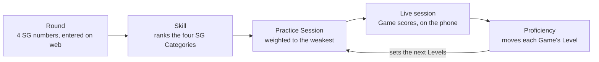

# gtrack design brief

As of 17 November 2026.

gtrack is a golf practice app: golfers log Rounds with Strokes Gained, see where they lose strokes over time, and get Practice Sessions of Drills and Games that target their weakest part of the game and adapt as they improve. It runs on iOS, Android and the web. We need design to own its UI, UX and a design system that spans both platforms.

## Who it's for

Two roles use gtrack, and nobody can sign up on their own: an admin invites each golfer by email. v1 is a small group, not a public release.

| Role | Who they are | What they need from the app |
| --- | --- | --- |
| Golfer | A club golfer who already gets Strokes Gained numbers from a separate SG app after each Round | Turn those numbers into practice: what to work on, a session that fits today's visit, and proof over time that it's working |
| Admin | The person running the app; also a golfer | Invite and manage golfers, and curate the Catalogue of Games and Drills that sessions are built from |

The golfer's problem today: they can see which part of their game costs strokes, but nothing turns that into what to do at the range. Practice drifts to what they enjoy, Games have no comparable record, and nothing adjusts difficulty as they improve or after a break.

Privacy is a core promise: no one, admin included, ever sees another golfer's Rounds, sessions or scores.

## Where each flow lives

The web is for sitting down: entering Rounds, reading trends, planning and reviewing. The phone is for the range: running a live Practice Session. Admin work is web only.

| Flow | Web | Phone |
| --- | --- | --- |
| Sign in (email code, Google) | Yes | Yes |
| Enter, edit and delete Rounds | Yes | No |
| Strokes Gained trends | Yes | No |
| Manage Practice Grounds | Yes | Yes |
| Weekly Plan (seven-day strip) | Yes, offered after saving a Round | Yes |
| Start an Unplanned Session | No | Yes |
| Live Practice Session | No | Yes, phone only |
| Review past Practice Sessions | Yes | No |
| Watch or abandon a session in progress (lost phone) | Yes | No |
| Settings, link Google, delete my account | Yes | No |
| Admin: users, Catalogue, Drafts, LLM usage | Yes, admin only | No |

Phone builds are installed locally for now, with no App Store or Play Store release in v1.

## Words to design with

The app uses these terms exactly, capitalised, in every label and message. Please use them in designs too, and avoid the synonyms in the last column: they mean something else here or confuse golfers.

| Term | Meaning | Avoid |
| --- | --- | --- |
| Round | One played round of golf: date, course, score, handicaps and Strokes Gained | Game (reserved for practice), scorecard |
| Strokes Gained (SG) | How many strokes better or worse than a Baseline; signed, two decimals, e.g. +1.05 or -2.10 | SG score, rating |
| SG Category | One of four parts of the game: Off the Tee, Approach, Short Game, Putting | Area, skill area, Around the Green |
| Baseline | The standard SG is measured against, e.g. Tour or Scratch | Benchmark, par |
| Handicap Index | The golfer's portable measure of ability, e.g. 12.4 | Handicap on its own, Proficiency, Skill |
| Course Handicap | Strokes received on one course and set of tees | Handicap on its own, playing handicap |
| Skill | How the golfer performs on the course in an SG Category, from Rounds; decides what to practise | Ability, level |
| Focus | The part of an SG Category to work on (a distance, a miss direction), from advanced Round stats | Weakness, target |
| Practice Ground | A named place the golfer practises, with its Facilities | Venue, club, range |
| Facility | Range bay, chipping area, putting green or practice bunker | Venue, location |
| Practice Session | An ordered plan of Drills and Games for one visit | Workout, plan, routine |
| Session Item | One entry in a Practice Session: a warm-up, a Drill or a Game | Block, step |
| Weekly Plan | Practice Sessions for the next seven days | Schedule, program |
| Unplanned Session | A Practice Session made on the spot, outside a Weekly Plan | Ad-hoc session, quick session |
| Generation | One run that chooses the Drills and Games for a Weekly Plan or Unplanned Session | Build |
| Drill | Repetitive practice with no score | Exercise |
| Game | A practice challenge with rules and a score that compares over time | Challenge, test, Round |
| Level | A Game's difficulty step, 1 to 5 | Tier, grade, difficulty score |
| Proficiency | How well the golfer plays one Game, shown as its Level; decides how hard it is | Skill, handicap, rating |
| Variation | The same Game with different setup wording; rules and scoring unchanged | Remix, new Game |
| Catalogue | The approved Games and Drills sessions are built from | Library, template list |
| Draft | A proposed Game waiting for an admin to approve it | Template, candidate |

The full glossary is [GLOSSARY.md](../GLOSSARY.md).

## The core flows

gtrack is one loop: Rounds say what to practise, sessions say how, and Game scores set how hard the next session is.

Each new Round re-ranks the SG Categories, and each session's Game scores move Levels for the next one.

**1. Get in.** An admin invites the golfer by email. The golfer signs in with a 6-digit code sent by email (no password), or with Google once linked. Uninvited emails get the same "check your email" screen, so the app never reveals who has an account. On first sign-in the golfer must give a fallback Handicap Index before anything else.

**2. Enter a Round (web).** After each Round the golfer copies four Strokes Gained numbers from their SG app, one per SG Category, plus score, course, Handicap Index, Course Handicap and Baseline. Course and handicap details carry over from the last Round, so SG entry leads. Optional advanced stats add fairways and misses, Approach miss percentages, up and downs, and SG by distance band (7 Approach bands, 11 Putting bands). Entering any band computes and locks that category's total.

**3. Watch the trends (web).** Four small charts, one per SG Category, show rolling averages over the last 5 and last 20 Rounds, normalised to 18 holes, with a zero line. Trends only mix Rounds with the same Baseline.

**4. Set up Practice Grounds (web or phone).** The golfer saves each place they practise, ticks its Facilities and their features (for example a range bay with grass or mats and distance signs), and can add a note.

**5. Get a Practice Session.** Two ways:

- **Weekly Plan:** offered after saving a Round. The golfer enters each planned visit for the next 7 days (minutes, Practice Ground, Facilities). Practice time is shared 50/25/15/10 across SG Categories, weakest first. It shows as a strip of seven days with one day open. Missed sessions simply lapse, so nobody is ever behind.
- **Unplanned Session (phone):** at the range, the golfer picks the Practice Ground, minutes, today's Facilities and an optional ball cap, with the split previewed live. The session covers the two weakest SG Categories the Facilities allow, split 2:1.

Each session runs a short warm-up, then for each SG Category about one third Drills and two thirds Games, grouped by Facility to cut walking. The golfer can swap any Session Item or regenerate. A Game card may carry one line saying why it was picked, such as "Picked for your 150 m+ Approach". If an SG Category was skipped because no Facility allows it, the session says so.

**6. Play it live (phone).** A black, high-contrast screen shows one Session Item at a time, with the rules behind a button. Scoring depends on the Game: a tap-anywhere counter with -1 for hit-or-miss, a large pad that adds up points or strokes with Undo, or a running clock with Cleared and Back one hole for the timed Game. A connection chip is always visible. The session survives a dropped connection or the app being killed, and uploads when it can. Ending early is allowed.

**7. Levels move.** Each Game has five Levels. After a session, two scores in a row beyond a target move the Game up or down one Level. After 8 weeks away from an SG Category, its Games start one Level easier.

**8. Review (web).** The golfer reviews past Practice Sessions with their scores and the Level each Game was played at. While a session is in progress on the phone, the web shows its uploaded progress and offers Abandon for a lost phone.

**9. Admin (web).** Admins invite and manage golfers, and curate the Catalogue: edit Games and Drills, write Games by hand with five Levels of settings and targets, ask the LLM for Drafts, and approve or delete them. Changing a Game's rules publishes a new version and keeps old scores labelled, for example "v2, replaced v1 on 3 March".

## Screen inventory

Six web screens and the phone sign-in are built, all as plain phone-width pages waiting for design. Everything else is planned. Built screens can be redesigned freely; they hold no design decisions worth keeping beyond layout C.

| Screen | Platform | Status |
| --- | --- | --- |
| Sign in: email, then 6-digit code | Web, phone | Built |
| Fallback Handicap Index (first sign-in) | Web | Built |
| Home | Web, phone | Built, placeholder only |
| Rounds list | Web | Built |
| Round entry and edit, with SG keypad | Web | Built |
| Admin: Users (invite, roles, disable) | Web | Built |
| Advanced Round stats and distance bands | Web | Planned |
| Strokes Gained trends | Web | Planned |
| Practice Grounds list and editor | Web, phone | Planned |
| Weekly Plan: seven-day strip | Web, phone | Planned |
| Unplanned Session setup with live split preview | Phone | Planned |
| Practice Session preview: swap a Session Item, regenerate | Phone, web | Planned |
| Live Practice Session: counter, pad, timer, rules dialog, connection chip | Phone | Planned |
| Session in progress (read-only) and Abandon | Web | Planned |
| Past Practice Sessions and scores | Web | Planned |
| Settings: link Google, delete my account | Web | Planned |
| Admin: Catalogue list, Game editor with five Levels, Drill editor | Web | Planned |
| Admin: Drafts (ask the LLM, edit, approve) | Web | Planned |
| Admin: starting Level bands, LLM caps and usage | Web | Planned |

Every screen also needs its empty, loading and error states. The ones specific to gtrack: no Rounds yet, no connection when generating (message and retry), the LLM monthly cap reached (a small note on the session), a lapsed planned session, and a session still uploading.

## Context of use

gtrack is used in two very different places, and the design system has to serve both.

**At the range (phone, live session):**

- Bright sun: hence the black, high-contrast live screen.
- One hand, often holding a club or wearing a glove: large targets, tap-anywhere scoring, nothing fiddly.
- Glanced at between shots: one Session Item at a time, the score readable from a step away.
- Patchy signal: connection status always visible, and nothing is lost offline.
- Mistakes happen: -1, Undo and Back one hole must be easy to reach.

**At a desk or on the sofa (web, and phone outside sessions):**

- Copying four signed numbers from another app after a Round: fast, keyboard-friendly entry with clear signs.
- Reading trends and reviewing sessions: dense, calm data with two-decimal numbers.
- Planning a week: seeing seven days at once.
- Admin editing: long, structured forms such as a Game with five Levels of settings and targets.

**Constraints across both:**

- Light and dark mode everywhere, with charts that follow the mode.
- Strokes Gained always signed with two decimals (+1.05, -0.40, 0.00): positive is better than the Baseline, negative is worse. Colour can reinforce the sign but must not be the only signal.
- The four SG Categories are a recurring set: they appear in entry, trends, session splits and Game cards, so they likely want consistent identities.
- Web must work from phone width up to a wide desktop. Today it's phone-width only; how it should use a wide screen is an open decision (see the last section).

## Already decided

These are settled and built on. Design can challenge them, but changing one has a cost, noted in the last column.

| Decision | What it means for design | Cost to change |
| --- | --- | --- |
| HeroUI v3 on web (`@heroui/react`) and HeroUI Native on phone (`heroui-native`, styled with Uniwind) | The design system should map onto HeroUI's theme tokens and components on both platforms; there is no shared UI package between them | High: swapping libraries reworks every screen |
| Tailwind CSS v4 on web, Tailwind via Uniwind on phone | Tokens become CSS variables and Tailwind classes | High |
| Layout C: SG first, carried-over details folded under one line with Change | The reference for every flow at phone width, chosen over a one-page form and a one-question-per-screen wizard | Medium |
| Custom SG keypad with ± and Next on web and phone | Phone decimal keypads have no minus key; the keypad moves through the four SG Categories in order | Low on web, medium on phone |
| Live Practice Session screens are custom (counter, pad, timer) | Not stock components: design them from scratch for the range | Low |
| Charts use Recharts 3 on web: four small line charts, linked hover, zero line | Chart colours must be CSS variables that follow dark mode | Medium |
| No App Store or Play Store release in v1 | No store screenshots, listings or app icon deadlines yet | None |

The current UI reference is a throwaway HTML prototype of layout C (Round entry, Weekly Plan, Unplanned Session and live session at phone size). We can share it on request.

## What we need from design

Three deliverables, in this order: the web layout decision first, because three upcoming build slices wait on it.

1. **A wide-screen web layout.** An app shell and navigation for golfers and admins, and how it narrows to phone width. Round entry, list and detail pages, the trends charts and the admin editors at desktop size. This is the open map ticket [How should the web pages use a wide screen?](https://github.com/simhen79/gtrack/issues/50), which blocks advanced Round stats, trends and the Catalogue.
2. **A design system for both platforms.** Colour (light and dark, plus the high-contrast live-session theme), type, spacing, radius and elevation tokens that map onto HeroUI's theme on web and HeroUI Native on phone. Include patterns for signed SG numbers, the four SG Categories, Levels 1 to 5, connection status and LLM notes on cards.
3. **Screens and flows.** Every screen in the inventory with its empty, loading and error states, starting with the phone's live Practice Session, the screen most unlike a standard app.

**Open questions for design to answer:**

- Should the web use the SG keypad at all on desktop, or a plain number input when there's a keyboard?
- Does the live session's black, high-contrast look stay a separate theme, or become the phone's dark mode?
- How should the four SG Categories be told apart: colour, icon, or both, given colour can't be the only signal?
- What does the golfer see first on Home, once there are Rounds and sessions?
- Does the app need a brand (name treatment, logo, icon) for v1, given there's no store release?

Before designs are handed back for building, please check the facts in this brief against the latest spec, [Spec: Golf practice app v1](https://github.com/simhen79/gtrack/issues/17), which wins wherever the two differ.
